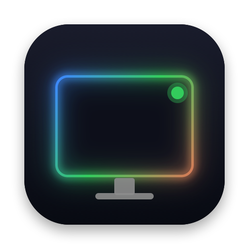
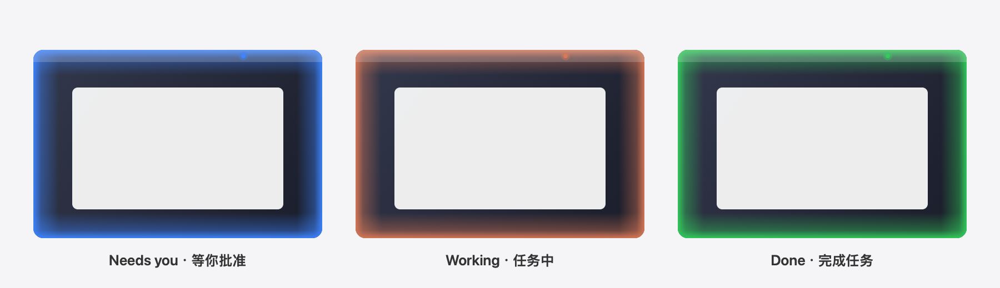

<p align="center"></p>

<h1 align="center">Agent Lumen · 灵光</h1>

<p align="center">让 AI 编程助手的状态，化成屏幕边缘的一圈光。<br>
A glow around your screen edge that tells you what your AI coding agents are doing.</p>

<p align="center"><a href="https://github.com/hongqi7/agent-lumen/releases/latest"><b>⬇︎ 下载 Download</b></a></p>



> English is [below](#english).

## 它做什么

你让 Claude Code（或 WorkBuddy、Devin）去干活，自己切到别的窗口。Agent Lumen 会用颜色告诉你它现在什么情况，不用来回切窗口看：

| 状态 | 状态栏光点 | 屏幕边缘 |
|---|---|---|
| 🔵 **等你批准**（权限确认、选择题） | 蓝色快速呼吸 | 蓝光呼吸（约 1.2 秒一次） |
| 🟠 **任务中**（思考、调用工具） | 橙色呼吸 | 橙光呼吸（约 2 秒一次） |
| 🟢 **完成任务** | 绿色呼吸 | 绿光呼吸（约 3 秒一次） |
| 空闲 | 空心小圆圈 | 不亮 |

- 三种光各有开关和**强弱滑块**（无极调节），拖动时实时预览。
- 同时开多个会话、多个工具也没问题：显示最紧急的那个（蓝 > 橙 > 绿），点开菜单能看到每个工具有几个会话、各是什么状态。
- 屏幕边缘发光**不挡鼠标**，多块屏幕、全屏应用里都能看到。
- 很省资源：只在有灯在动时刷新，实测 CPU 约 1%。不联网，不收集任何数据。

## 支持的 AI 工具

| 工具 | 配置文件 | 说明 |
|---|---|---|
| Claude Code（命令行、桌面版 Code 页、IDE 插件） | `~/.claude/settings.json` | |
| WorkBuddy | `~/.workbuddy/settings.json` | |
| Devin（本机会话） | `~/.config/devin/config.json` | 首次运行要在「信任此工作区」时选信任；云端会话不会亮灯 |

三家都用同一种「钩子」格式：工具在你发消息、用完一个工具、请求权限、一轮结束时，各运行一条命令。Agent Lumen 加的就是这几条命令，它们只往 `~/.agent-lumen/sessions/` 里写一个表示状态的单词。

## 安装

1. 到 [Releases](https://github.com/hongqi7/agent-lumen/releases/latest) 下载 `AgentLumen-x.y.z.zip`，解压，把 **Agent Lumen.app** 拖进「应用程序」。
2. 第一次打开：这个 App 没有付费做苹果公证，macOS 会提示「无法验证开发者」。**右键点 App → 打开 → 打开**即可，只需一次。
   也可以在终端执行：
   ```bash
   xattr -dr com.apple.quarantine "/Applications/Agent Lumen.app"
   ```
3. 打开后会问你要不要接入检测到的 AI 工具，点「接入」。改之前会自动备份原配置文件（`*.bak-agent-lumen-时间戳`）。
4. 已经开着的会话要重新打开才会亮灯。
5. 状态栏出现一个小圆点就是它。点开菜单可以调亮度、开关各种光、勾选「开机自动启动」。

> 状态栏图标太多的话，新图标可能被 Bartender / Ice 这类工具折叠起来，记得把它拖出来。

支持 macOS 13 及以上，Apple 芯片和 Intel 都能用。

## 断开与卸载

- 菜单「接入的 AI 工具」里点已接入的工具，就会把它的钩子去掉；也可以在终端执行：
  ```bash
  "/Applications/Agent Lumen.app/Contents/MacOS/AgentLumen" --disconnect
  ```
- 然后退出 App，删掉 `Agent Lumen.app`、`~/.agent-lumen`，开过开机自启的再删 `~/Library/LaunchAgents/io.github.hongqi7.agent-lumen.plist`。

## 和键盘灯一起用

如果你也在用 [nuphy-air60-v2-claude-light](https://github.com/hongqi7/nuphy-air60-v2-claude-light)（让 NuPhy 键盘侧灯显示同样的状态），Agent Lumen 会直接读键盘灯记录的状态，不会再重复加钩子，菜单里显示「已通过键盘灯接入」。

## 自己编译

```bash
git clone https://github.com/hongqi7/agent-lumen.git
cd agent-lumen
./build.sh            # 生成 build/Agent Lumen.app 和 zip（通用二进制）
./build.sh install    # 顺便装到 /Applications 并打开
```

只需要 Xcode 命令行工具（`xcode-select --install`），没有任何第三方依赖。代码就一个文件：[`Sources/AgentLumen.swift`](Sources/AgentLumen.swift)；钩子脚本是 [`Resources/lumen-hook`](Resources/lumen-hook)；图标由 [`scripts/make-icon.swift`](scripts/make-icon.swift) 画出来。

## 已知限制

- 按 Esc 打断 Claude 时不会触发「结束」钩子，状态会停在「任务中」；2 小时没有动静会自动算作完成。
- Claude Code 在回复正文里用文字问你（而不是弹出提问框）时，算作「完成任务」。
- 只做了 macOS。

---

## English

You hand a task to Claude Code (or WorkBuddy, or Devin) and switch to another window. Agent Lumen shows its state as a colour, in the menu bar and as a soft glow around the edge of every screen:

| State | Glow |
|---|---|
| 🔵 **Needs you**: a permission prompt or a question | blue, fast breathing |
| 🟠 **Working**: thinking or running tools | orange, breathing |
| 🟢 **Done** | green, slow breathing |

- Each colour has an on/off switch and a stepless brightness slider (drag to preview).
- Several sessions and agents at once: the most urgent wins (blue > orange > green); the menu lists every agent's sessions.
- The glow is click-through and shows on every display and over full-screen apps. About 1% CPU, no network access, no data collection.

**Supported agents:** Claude Code (`~/.claude/settings.json`), WorkBuddy (`~/.workbuddy/settings.json`), Devin local sessions (`~/.config/devin/config.json`; answer Devin's workspace trust prompt). All three use the same hook format. Agent Lumen adds a few hook commands that write a single word to `~/.agent-lumen/sessions/`.

**Install:** download the zip from [Releases](https://github.com/hongqi7/agent-lumen/releases/latest), unzip and move **Agent Lumen.app** to Applications. The app is not notarized, so the first time **right-click → Open → Open** (or run `xattr -dr com.apple.quarantine "/Applications/Agent Lumen.app"`). On first launch it offers to connect the agents it finds and backs up each settings file first. Restart sessions that were already open. macOS 13+, Apple silicon and Intel.

**Disconnect:** click a connected agent in the menu, or run `"/Applications/Agent Lumen.app/Contents/MacOS/AgentLumen" --disconnect`. Then delete the app, `~/.agent-lumen` and, if you enabled it, `~/Library/LaunchAgents/io.github.hongqi7.agent-lumen.plist`.

**Build:** `./build.sh` (needs only the Xcode command line tools). One source file, no dependencies.

Works alongside [nuphy-air60-v2-claude-light](https://github.com/hongqi7/nuphy-air60-v2-claude-light), which shows the same states on a NuPhy keyboard's side lights. Agent Lumen reads its state and does not add duplicate hooks.

Not affiliated with Anthropic, Tencent or Cognition. MIT License.
